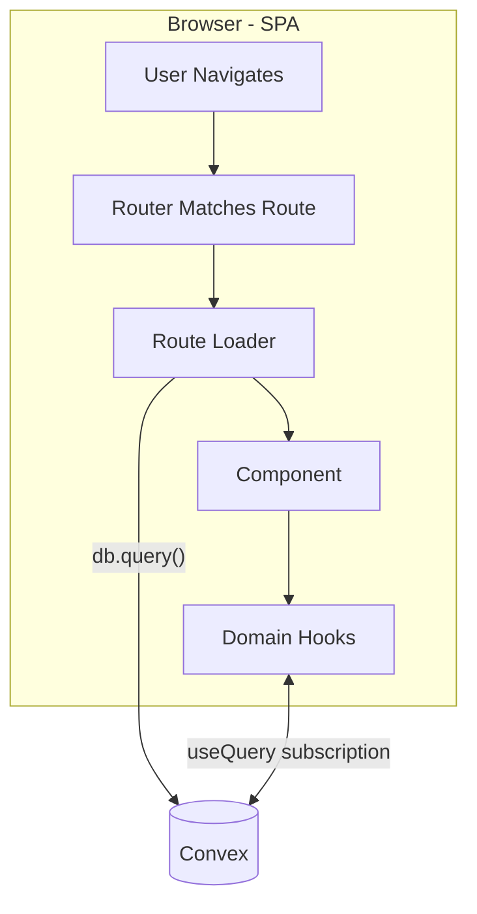
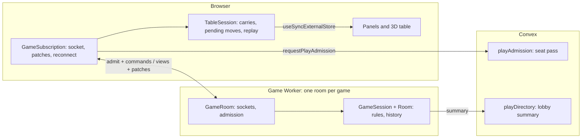

# Architecture

## Request flow (SPA - all client-side)

Loaders fetch once through `db.query()` for first paint; components then subscribe through domain
hooks, and Convex pushes updates for the life of the screen. There is no client cache; see [State
Management](./state-management.md). The runtime is browser-first SPA, with TanStack Start prerender
used for static output during builds.

## Play data flow (WebSocket, not Convex)

A Play table does not live in Convex. Convex holds the lobby, game addresses, provisioning and seat
passes; every move, seat and private hand lives in the game Worker, one SQLite Durable Object per
game, and reaches the page over a WebSocket.

- The Worker is the only authority. It projects each viewer's visible state, hiding other seats'
  private information, before it computes patches. The browser never applies its own moves to the
  shared state and retries nothing after a reconnect.
- The messages both sides exchange are Zod schemas in `src/shared/play/protocol.ts`, versioned by
  `PLAY_PROTOCOL_VERSION`; the rules the browser previews with (carries, drops) are the same shared
  functions the Worker runs.
- Details: [Hosted table](./technical/play-hosted.md) for admission, seat passes, history and the
  protocol version; [Hosted table subscription](./technical/play-subscription.md) for what the
  browser owns and how it reconnects.

## Validation flow

For mutation inputs, validation happens in three stages:

1. Optional client-side parse (UX feedback only).
2. Convex function boundary validation via `v.*` argument validators.
3. Convex handler semantic validation via shared Zod `safeParse` (authoritative).

This keeps input types strict at the API edge and business rules centralized in shared schemas.

## File-based routing

Routes live in `src/app/routes/`. File structure maps to URLs, except that the `_app` segment is a
pathless layout route and is stripped: `_app/index.tsx` → `/`, `_app/auth/login.route.tsx` →
`/auth/login`. Nearly every visual route lives under `_app`, which supplies the application chrome.
Route tree auto-generates: [`src/app/routeTree.gen.ts`](../src/app/routeTree.gen.ts). Details in
[Routing](./routing.md).

## Path aliases

Configured in [`tsconfig.json`](../tsconfig.json):

- `@db/core` → `src/app/db/core/index.ts` (DB client, types)
- `@db/storybook` → `src/app/db/storybook/index.ts` (the page-story database and its provider)
- `@db/*` → `src/app/db/*.ts` (domain data modules)
- `@app/*` → `src/app/*` (app code)
- `@ui/*` → `src/app/ui/*` (every published component)
- `@shared/*` → `src/shared/*` (contracts the app, `convex/` and `workers/` all parse against)
- `@game/*` → `src/game/*` (print-faithful renderers)
- `@sb/*` → `.storybook/*` (Storybook preview, for stories)

## Where components live

Which category a component belongs to is decided by the taxonomy in
[`AGENTS.md`](../AGENTS.md#component-taxonomy), canonically. The architectural facts are these:

- `src/app/ui/**` holds **every** published component, filed by category (`block`, `content`,
  `control`, `layout`, `list`, `surface`), imported through the `@ui/*` alias. One rule guards it,
  in [`.oxlintrc.json`](../.oxlintrc.json): a component renders what it is given and does not go and
  get things. No Convex client, no *value* imports from `@db/**` (`import type` is fine and
  expected), and no router data hooks: `Link` stays allowed, `useNavigate` does not.
- `src/app/**` is the application: routes (which own their own page composition), domain data
  modules (`db/<domain>.ts`), the shell (`shell/`), document-rendering glue (`print/sheet/`,
  `print/capture/`), the fetching controls (`pickers/`), `widgets/<name>` for assemblies two or
  more routes install whole, and the global stylesheets (`styles/`). That top level is a closed
  set, held by `bun run check:app-layout`. There is no `components/` directory here; every
  published component lives in `src/app/ui`.
- `src/game/**` holds print-faithful renderers, independent of Mantine and the kit.

## How things come together

### Example: Loading a faction page

1. Route [`src/app/routes/_app/factions/$factionId/index.tsx`](../src/app/routes/_app/factions/$factionId/index.tsx):
   `ssr: true` renders it on the server, and its `loader` calls `loadPublicFaction` through
   `db.query()` before first render, throwing `notFound()` for an unknown slug. `head` builds the
   title, description and canonical URL from that same loader data.
2. Domain hook [`src/app/db/factions.ts`](../src/app/db/factions.ts): `useFaction(slug, { initialData:
   loaderData })` subscribes via Convex `useQuery` and keeps the screen live.
3. Database: a Convex document database with function-level authorization checks.

See [README](./README.md) for workflows.
