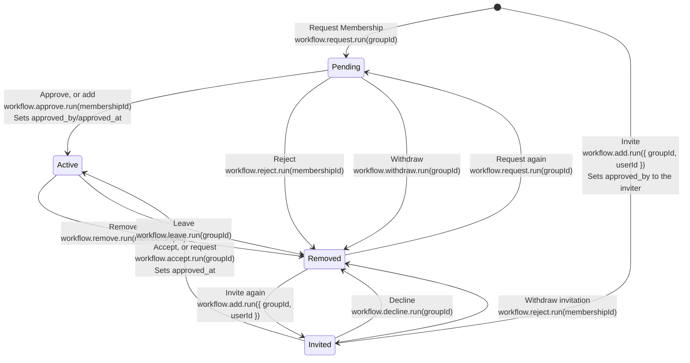

# Membership

## Approval flow

Membership takes both sides' consent (Norbert, 2026-11-07). A request is the person's half and an
invitation is the Group's; the row becomes `active` once the other half arrives, whichever came
first. So adding someone who already asked approves their request, and a person asking to join a
Group that already invited them accepts the invitation. Rejection, removal, withdrawal, declining
and leaving all move a membership to `removed`, from which either side may start again. The owner
cannot leave: ownership moves only through account deletion.

## Status enum

**Type**: an inline Convex literal union on the `group_members` table
([`convex/schema.ts`](../convex/schema.ts)), mirrored client-side in
[`src/app/db/members.ts`](../src/app/db/members.ts)

- `pending` - Membership requested, awaiting the Group's approval
- `invited` - Invited by an active member, awaiting the person's acceptance. Grants nothing: an
  invited person has every capability a stranger has and no more, is on no roster and no profile,
  and is not a possible replacement owner for account deletion
- `active` - Approved or accepted, active member
- `removed` - Rejected, declined, withdrawn, removed, or left

## Viewer access projection

Page queries hand each detail route a `viewerAccess` already narrowed to that page's kind, as
`Extract<CollaborativeAccess, { kind: 'faction' }>` and so on
([`src/app/db/factions.ts`](../src/app/db/factions.ts), [`groups.ts`](../src/app/db/groups.ts),
[`rulesets.ts`](../src/app/db/rulesets.ts)). Routes read
`viewerAccess.capabilities.*` directly. There is deliberately no client-side projection helper
between the two: one existed, took the *wide* union, and re-narrowed at runtime what every caller
already knew statically.

Three properties of the wire shape are worth knowing before writing defensive code against it:

- **`viewer.membership` has three states, not five.** `'removed'` and `'invited'` are
  server-internal: they live on the stored `group_members` row and on `ViewerFacts`, and
  `evaluateCollaborativeAccess` collapses both to `'none'` before projecting
  ([`convex/lib/collaborativeAccess.ts`](../convex/lib/collaborativeAccess.ts)). A removed member
  is indistinguishable from a stranger to the client, which is what lets them request membership
  again; an invited person is one too until they accept, and the invitation itself travels
  separately, through `members.viewerInvitations`, which only the invited person is answered by.
  So `Record<MembershipState, …>` over the viewer's status is exhaustive with three keys, and a
  bundle that predates invitations never receives a status it does not know.
- **Every capability is a non-optional boolean.** The validators declare `v.boolean()`, so
  `capabilities.edit ?? false` is dead code; read the field.
- **A group-kind access has no `edit`, `changeGroup` or `assignedGroup`.** Those are asset-only, and
  the per-kind narrowing means the compiler enforces it rather than a runtime `kind` check.

### Group assignment affordances

For an asset, `group.eligible` is `assignedGroup !== null`, and a soft-deleted or dangling group
reference projects to `assignedGroup: null` while the row's own `group_id` stays set. The client
rule follows from that pair, not from `assignedGroup` alone:

- **Offer assignment** only when the row carries no assignment at all, meaning
  `changeGroup && group_id == null`.
- **Keep removal available** whenever the row is assigned, including when the group no longer
  resolves, meaning `changeGroup && group_id != null`.

The dangling case is the one that matters: the owner sees **Remove from group**, never **Assign to
group**, because assigning is the wrong repair for a reference that already exists. Server-side
coverage is in [`convex/groups.softDeletion.test.ts`](../convex/groups.softDeletion.test.ts); the
client branch is two expressions in
[`rulesets/$rulesetSlug/index.tsx`](../src/app/routes/_app/rulesets/$rulesetSlug/index.tsx) and is
recorded here because inlining the projection removed the unit test that used to state it.

## Approval metadata

`approved_by` and `approved_at` record the Group's half of the agreement. Approving a request sets
both. An invitation sets `approved_by` to the inviter at once, since the Group has agreed, and
`approved_at` when the person accepts. `requested_at` is when the row's first half arrived, the
request or the invitation.

## Client workflow

`useGroupMembershipWorkflow` exposes the named commands with normalized pending and error state:
the viewer's own `request`, `withdraw`, `accept`, `decline` and `leave`, each by Group id;
moderation's `approve`, `reject` and `remove`, each by membership id; and `add`, which sends an
invitation. Group detail consumes the canonical Group page projection: `viewerAccess` controls
viewer actions, while each `roster` row controls approve, reject, and remove actions. The viewer's
invitations come from `useViewerInvitations`, on the Group page and on the viewer's own profile; a
Group's open invitations come from `useGroupInvitations`, mounted for active members alone, and the
invite picker (`GroupInvitePicker`) reads its candidates through `useInviteCandidates`. Callers pass
`membershipId` for moderation and never reconstruct authorization from raw membership rows.

Asset page queries provide server-derived `assignableGroups`; assignment controls do not query or
filter raw membership rows.

**Example**: [`src/app/db/members.ts`](../src/app/db/members.ts)

## Authorization

Convex handlers in `convex/members.ts` enforce authorization through the trusted collaborative-access
module:

- **`approveRequest`**: Caller must be an **active** member of the Group. Target row must be **`pending`**.
- **`rejectRequest`**: Caller must be an **active** member of the Group. Target row must be **`pending`** (declining a request) or **`invited`** (taking an invitation back).
- **`removeMember`**: Only the **Group owner** may remove someone else. The owner cannot be removed. Target must be **`active`** (pending requests are handled with `rejectRequest`).
- **`request`**: Any authenticated user may request membership. On an **`invited`** row it accepts the invitation.
- **`addMember`**: Any active member may invite another user, who must have a public profile. On a **`pending`** row it approves the request instead; on an `active` or `invited` row it changes nothing.
- **`acceptInvite` / `declineInvite`**: Only the invited person, on their own **`invited`** row.
- **`withdrawRequest`**: Only the requester, on their own **`pending`** row.
- **`leave`**: Only the member, on their own **`active`** row; the Group owner is refused. Clears the Group as the member's default, as removal does.

Only the canonical membership transport is public: the viewer's own commands by `group_id`, the
membership-ID moderation commands, and `addMember({ groupId, userId })`. Page queries expose
purpose-built `viewerAccess`, `roster`, `assignableGroups`, and `groupSummaries` projections rather
than raw membership rows. Invitations are the one membership state with its own reads, because a
public page may not carry them: `viewerInvitations` answers the invited person, `groupInvitations`
answers a Group's active members and nobody else, and `inviteCandidates` pages the public profiles
an active member may invite, by slug prefix, excluding anyone with an open membership of the Group.

## Account deletion

A deleting account may hand its direct ownership only to a **co-member**: an active member of a live
Group the deleting account is also an active member of (Norbert, 2026-11-07, after the security
audit). User ids are public, so without this anyone could dump their content on a stranger and lock
that stranger's settings while the operation ran. An invited or pending person is not a co-member.
`accountDeletion.confirm` enforces it; `listReplacementProfiles` offers only co-members, each once,
bounded by `REPLACEMENT_GROUP_LIMIT` Groups of `REPLACEMENT_GROUP_MEMBER_LIMIT` members and paged
by offset over that list. The apply phase keeps its own check on the replacement account's state
and does not repeat the co-member rule: by then the deleting account may already have left the
Groups it shared.

The transport was widened before every application caller moved to that contract. The narrowing
release may deploy only while the canonical Worker cutover commit
`3a67eb6f523f0d15811d9725e9a63c11ad47c1d8` or a descendant is live. Once Convex is narrowed, a
rollback to an older Worker requires Convex to be re-widened first.

## Group-associated content

Groups are collaboration boundaries shared by factions, rulesets, and future community assets.

- Active members may edit content associated with their group.
- Only the asset owner may delete it or assign, unassign, or move it between groups.
- Only an entity's owner may rename it: a group, a ruleset, a faction, a community asset or a
  rulebook. A rename recalculates the slug and moves the public URL with no redirect behind it, so it
  is an identity change rather than an edit, which is why an active member keeps every other control
  and loses this one.
- Asset display names may repeat. Creating or renaming an asset uses its name's slug, then an increasing
  numeric suffix within its type: `lasgun`, `lasgun-1`, `lasgun-2`. Content saves keep the
  current URL when the name is unchanged. A crowded range of existing numbered slugs uses a short
  random suffix to keep saves bounded. Treachery conversion keeps its slug when available in the
  custom-card type and adds a suffix when occupied.
- Renaming releases the former slug. A soft-deleted entity keeps its current slug reserved.
- Active members may add or remove factions from a ruleset without deleting either asset.

## FAQ ownership and moderation

- A question author may edit or delete their question and accept or unaccept its answers, regardless
  of the ruleset's group membership.
- An answer author may edit or delete their own answer.
- The question author may delete answers on their question, but may not edit another author's text.
