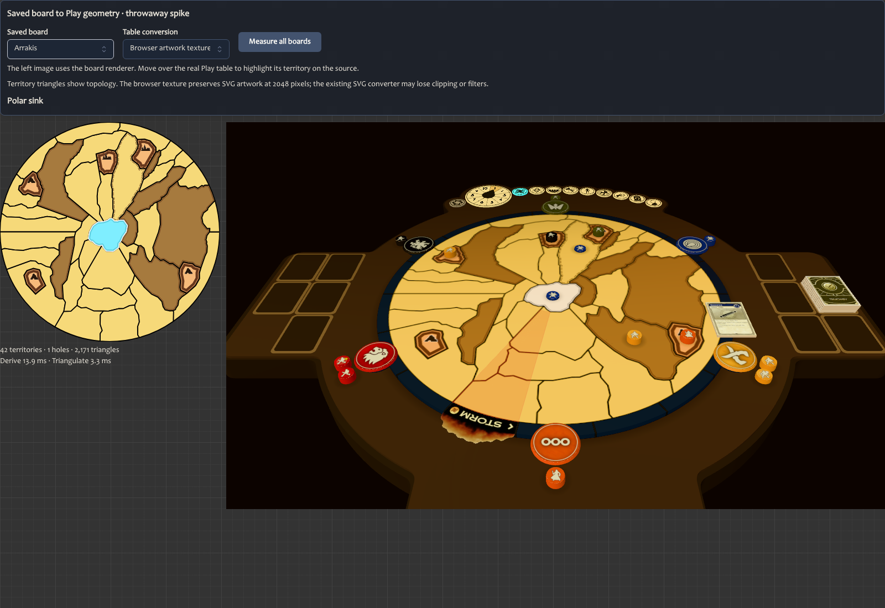
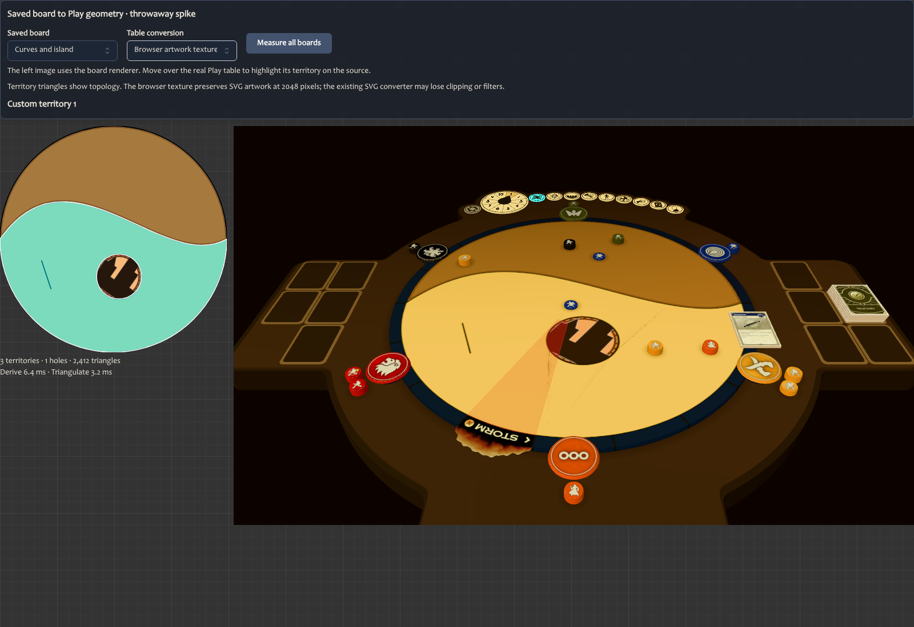
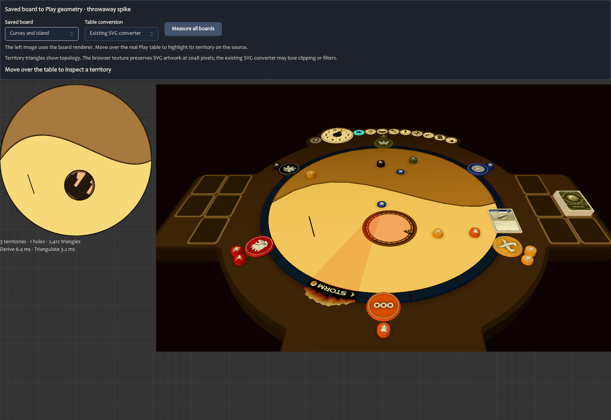

# Saved board geometry on the table

Throwaway spike for [Spike saved board geometry in the Play table](https://github.com/ndelangen/dunezone/issues/2111), under [Integrate authored board assets into Dune Play, phase 2](https://github.com/ndelangen/dunezone/issues/1958).

Built on main `6bd51cc9933ba363e68b43905bf4afe39073c599`, 13 October 2026. Keep this branch out of main. Its context injection, inspector and measurement code are experiments, not a production board-loading contract.

## Verdict

The saved board contract can supply the real Play table's territory geometry and picking. The existing `derive` function supplies outer rings and holes; Three's triangulator converts them into upward-facing triangles. Each triangle retains its territory index. One coordinate transform maps editor space to the table and supplies texture coordinates.

The generic SVG converter is not a faithful artwork path. Its output drops the authored decal in the custom enclosed-island example, and the loader reports unsupported filters. Passing the board's complete SVG to it is insufficient.

The hybrid works in this experiment: use territory triangles for rendering and ray picking, with browser-rendered board artwork as a texture. The textured island preserves the oversized, rotated decal clipped to its territory. The actual table supplies lighting, pieces, storm and camera; this is not a replacement table scene.



## Run

After the normal frozen dependency install, run this from the worktree root:

```sh
bun run spike:board
```

Open [the inspector](http://localhost:6113/iframe.html?id=widgets-tabletop-boardgeometry-prototype--inspect&viewMode=story). It starts with the textured Arrakis board. Choose a saved board and a conversion path. Hover the table to highlight the corresponding territory on the SVG reference. `Measure all boards` prints the measurements.

To repeat the browser measurements and screenshots while the server is running:

```sh
bun src/app/widgets/tabletop/boardGeometry.prototype.capture.mjs
```

The script writes into `docs/prototypes/board-table-geometry/proof`. An optional path argument chooses another output directory. Inputs pass through a JSON round trip and `BoardDefinition.parse`; they are saved-format fixtures, not live production records.

## Evidence

Five measured runs in headless Chromium 151 on an Apple M1 Pro. The renderer used WebGL2 because this browser had no WebGPU adapter. These are local conversion measurements, not device coverage or frame-rate results.

| Saved board | Territories | Holes | Triangles | Derive and triangulate, median | Observed range | Picking probes |
|---|---:|---:|---:|---:|---:|---:|
| Arrakis | 42 | 1 | 2,171 | 17.0 ms | 16.5 to 29.6 ms | 4,674 |
| Curves and island | 3 | 1 | 2,412 | 10.4 ms | 9.5 to 13.4 ms | 4,639 |
| Edited Arrakis | 42 | 1 | 2,171 | 17.2 ms | 16.0 to 20.8 ms | 4,674 |
| Blank | 1 | 0 | 718 | 3.1 ms | 2.6 to 3.2 ms | 4,257 |

All 18,244 locations matched independent SVG `Path2D` containment against actual Three ray hits in every run. That includes 1,772 probes on either side of boundaries at a 0.05 source-unit offset, plus a grid and every territory's interior point. There were no overlapping territory hits, downward-facing vertices, non-finite positions or unrecovered boundary segments. The custom board intentionally has one unfinished cut; it remains visible without inventing another territory. Triangle area agreed with derived polygon area before Float32 conversion to within 0.000000001 source square units.

Arrakis uses 312,624 bytes for positions, normals, colors and UVs, excluding outlines and textures. The generic SVG bridge produced 27,793 triangles for Arrakis and took a median 83.3 ms, excluding derivation. Texture decoding and upload are not included in these CPU measurements. A 2048-square RGBA texture is about 16 MiB before mipmaps, or 21.3 MiB with a full mip chain, before browser/source-image overhead.

[Raw samples](proof/samples.json) and [browser diagnostics](proof/browser.json) are retained. The final capture had no page exceptions or failed resource responses. The expected SVG-filter and WebGPU-fallback warnings remain visible in the diagnostics.





## Remaining risks and production shape

- The experiment imports the editor geometry engine and server-side SVG rendering into Storybook. Measure bundle cost before putting those dependencies on the Play loading path; publishing derived geometry is another option.
- Cache or precompute the board conversion when content loads. These costs do not belong in a pointer handler or animation frame.
- Keep rendered artwork and territory geometry tied to the same board revision and coordinate transform. The board's 487.06 view box includes a margin; the geometry circle has radius 242.5 around 243.53. Blindly using the full view box introduces a scale mismatch.
- The hybrid trades vector sharpness for texture resolution and memory. Choose a publication resolution and measure zoom quality, GPU upload and mobile memory. Browser rasterization here proves the appearance path, not the production publication/retention pipeline.
- The current curve sampler supplies the polygon rings. The probe set found no disagreements; it does not prove an error bound for every allowed curve or the maximum 512-territory/1024-edge input.
- Faint triangulation-shaped shading is visible on the broad custom sand region with the current table material and shadows. It does not create a territory-picking mismatch. Final material/shadow fidelity needs a focused follow-up.
- WebGPU and real phones were not verified. Storm membership, board revisions in retained games, ruleset selection, missing publications and board/deck policy are integration decisions outside this spike.

The useful production direction is a board conversion that returns geometry, territory identity and one shared transform, plus a separately verified artwork delivery path. The ruleset still chooses the board, and Spice-deck matching remains unenforced.

## Checks

Typecheck and lint pass. The existing Arrakis geometry and table SVG conversion suites pass, 11 tests. The prototype Storybook render passes. The repository check, including publisher dry run, passes with the documented placeholder build URL. Browser picking and visual comparison are recorded above. No production data, routes or deployments were changed.
