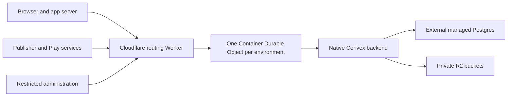

# Running our own Convex on Cloudflare

Research checked on 12 October 2026, alongside the
[usage investigation](convex-usage-research.md). Dune Zone source revision is
`3bc00a482a7e7014cc0c2719ee8e8f5c575757fc`. No infrastructure was provisioned.
Upstream source links refer to the main branch checked during research; a prototype
must select and test an exact backend image digest.

Convex in Cloudflare Containers looks technically plausible. The simplest durable
design uses a single native Convex backend, managed Postgres outside Cloudflare,
and private R2 buckets. A deployment entirely within Cloudflare has no documented
Convex database adapter today. Building one would be a backend engineering project.
This composition has not been tested by this investigation.

The current usage bill does not justify that work. Convex Cloud Starter projects
about $0.40 of October overage at the observed pace. Self-hosting makes sense only
if ownership, control or a different growth scenario justifies its operational cost.

## What can run where

| Approach | Evidence and judgment |
| --- | --- |
| Ordinary Worker | Cannot run the shipped native Rust/V8 backend. Worker Node compatibility does not provide a general native process host. |
| Container with local SQLite | Can run the binary, but Container disk disappears on replacement. Appropriate for disposable experiments. |
| Container with external Postgres or MySQL and R2 | Uses documented Convex persistence options. Best first prototype. |
| Container with D1 or Durable Object SQLite | No documented driver. Requires implementing Convex persistence behavior and testing recovery and transactions. |
| SQLite file mounted from R2 | A bucket mount does not establish database locking, atomicity, flush or crash guarantees. Exclude from the initial production design. |
| Container filesystem snapshots | Useful point-in-time recovery, but writes after a snapshot remain exposed. Not a substitute for continuous database durability. |

Sources: [Convex binary](https://github.com/get-convex/convex-backend/blob/main/self-hosted/advanced/running_binary_directly.md),
[Worker Node compatibility](https://developers.cloudflare.com/workers/runtime-apis/nodejs/),
[Container disk lifecycle](https://developers.cloudflare.com/containers/faq/),
[Convex database dispatch](https://github.com/get-convex/convex-backend/blob/main/crates/db_connection/src/lib.rs),
[SQLite on network filesystems](https://www.sqlite.org/useovernet.html).

Cloudflare now allows containers to call Workers and bindings through outbound
HTTP. That makes a custom D1 or Durable Object bridge possible to investigate; it
does not add a Convex driver. The driver would need document and index history,
transaction and conflict behavior, retention, lease ownership and recovery.
[Binding connections](https://developers.cloudflare.com/containers/configuration/workers-connections/).

## Proposed first topology

The hostnames below are illustrative and have not been configured.
Public clients use HTTPS/WSS on port 443; backend ports in the table are internal
Container ports.

| Endpoint or service | Purpose |
| --- | --- |
| `convex-api.dune.zone`, port 3210 | HTTPS client API, WebSocket subscriptions and deployment/admin API |
| `convex-http.dune.zone`, port 3211 | HTTP actions, OAuth callbacks and issuer discovery |
| Dashboard, port 6791 | Administration; initially run locally against the remote API or restrict hosted access |
| Managed SQL database | Durable documents, indexes and backend state |
| Private R2 buckets | Modules, file objects, search data, snapshot imports and exports |

Convex's [self-hosted setup](https://github.com/get-convex/convex-backend/blob/main/self-hosted/README.md)
and [dashboard configuration](https://github.com/get-convex/convex-backend/blob/main/self-hosted/advanced/dashboard.md)
describe these backend ports and administration. Protected functions still enforce
application authentication and authorization; anonymous catalogue reads remain public.
Do not put the deployment admin credential in a browser bundle or use a Cloudflare
Access login gate that blocks ordinary app clients.

Use one stable Container identity per environment and one active backend writer.
The initial design can use the default scheduling policy, `@cloudflare/containers`,
`max_instances: 1`, a fixed instance name, and readiness checks on both backend
ports. Forward WebSocket upgrades using `fetch()` and port selection; the
`containerFetch()` helper does not support WebSockets. Preserve method, body,
query parameters and authorization headers. API and auth responses must not acquire
an indiscriminate CDN cache.
[Container class](https://developers.cloudflare.com/containers/api/container-class/),
[WebSocket forwarding](https://developers.cloudflare.com/containers/examples/websocket/).

The newer `durable_object` scheduling policy is in public beta and uses
`ctx.container` directly. It has no `max_instances` setting and differs in image
selection, sizing and rollout behavior. Filesystem snapshots require that policy.
Choose one policy deliberately; do not combine examples from both APIs.
[Scheduling policies](https://developers.cloudflare.com/containers/configuration/scheduling-policy/).

## Durable storage requirements

Convex documents SQLite, Postgres and MySQL. It tests its SQL setup with Postgres
17 and MySQL 8 and recommends managed databases. Database round trips make placement
matter. Put SQL and the Container in nearby European regions and measure actual
latency; a placement preference does not guarantee the same city.
[SQL setup](https://github.com/get-convex/convex-backend/blob/main/self-hosted/advanced/postgres_or_mysql.md),
[Container placement](https://developers.cloudflare.com/containers/concepts/placement/).

Use a direct Postgres endpoint for the first experiment. Hyperdrive's connection
binding is designed for Worker clients, not an automatically available native
container endpoint. A bridge needs separate compatibility testing. Hyperdrive
query caching also lacks automatic write invalidation.
[Hyperdrive setup](https://developers.cloudflare.com/hyperdrive/get-started/),
[supported database features](https://developers.cloudflare.com/hyperdrive/reference/supported-databases-and-features/).

The self-hosted SQL guide expects `POSTGRES_URL` without a database name or query
parameters. Convex derives the database name from `INSTANCE_NAME`, replacing hyphens
with underscores. Current source requires TLS by default and uses a Rustls connector
with native CA roots and optional `PG_CA_FILE`. A pinned image still needs a real
certificate and hostname verification test. Do not copy the guide's local-only
`DO_NOT_REQUIRE_SSL` setting into production.
[Connection construction](https://github.com/get-convex/convex-backend/blob/main/crates/clusters/src/lib.rs),
[Postgres TLS connector](https://github.com/get-convex/convex-backend/blob/main/crates/postgres/src/lib.rs).

Configure all five storage categories through Convex's S3-compatible settings:

- `S3_STORAGE_EXPORTS_BUCKET`
- `S3_STORAGE_SNAPSHOT_IMPORTS_BUCKET`
- `S3_STORAGE_MODULES_BUCKET`
- `S3_STORAGE_FILES_BUCKET`
- `S3_STORAGE_SEARCH_BUCKET`

Also configure `AWS_REGION`, `S3_ENDPOINT_URL` and scoped R2 credentials. Keep the
buckets private. Convex documents R2 configuration; verify the chosen image's
checksum, upload and encryption requests against R2's supported S3 operations.
These buckets are separate in purpose from the existing public publisher assets.
[Convex S3/R2 setup](https://github.com/get-convex/convex-backend/blob/main/self-hosted/advanced/s3_storage.md),
[R2 S3 compatibility](https://developers.cloudflare.com/r2/api/s3/api/).

Add a startup guard that fails if SQL or any required object-storage setting is
missing. The current Docker entrypoint falls back to local SQLite when SQL is
absent and to local object storage when its required bucket variables are incomplete.
That fallback could appear healthy until a Container replacement deletes its data.
[Backend entrypoint](https://github.com/get-convex/convex-backend/blob/main/self-hosted/docker-build/run_backend.sh).

## Restarts, scheduled work and upgrades

Dune Zone has a one-minute deletion-repair cron and scheduled authentication work.
A backend that sleeps until a visitor arrives cannot maintain timely execution.
Use an independent controller alarm or Worker cron to start/check the singleton,
and budget for continuous operation first. A wakeup design needs to prove what
happens during long idle periods and platform restarts.
[App crons](../../convex/crons.ts), [authentication scheduling](../../convex/auth.ts),
[Convex scheduler semantics](https://docs.convex.dev/scheduling/scheduled-functions).

Cloudflare rollouts activate the new Worker before replacing container images.
Deployment success means the rollout started, not that replacement finished.
The stop sequence sends `SIGTERM`, then `SIGKILL` after 15 minutes if necessary.
Allow for temporarily mixed Worker/backend versions and broken WebSocket connections.
A singleton replacement can cause downtime.
[Rollout behavior](https://developers.cloudflare.com/containers/configuration/rollouts/).

Current Convex main source uses `ctrl_c()` for shutdown. Test the selected image's
`SIGTERM` behavior and, if needed, use a supervisor that translates `SIGTERM` into
`SIGINT` and waits for shutdown. Abrupt-stop testing is still necessary. The
Postgres implementation maintains writer lease ownership and initiates shutdown
after losing it; that is not proof of a working multi-instance high-availability setup.
[Backend shutdown](https://github.com/get-convex/convex-backend/blob/main/crates/local_backend/src/main.rs),
[Postgres lease implementation](https://github.com/get-convex/convex-backend/blob/main/crates/postgres/src/lib.rs).

Pin backend images. Before upgrades, preserve database backups, object storage,
configuration and credentials. An old image may not understand a database upgraded
by a newer image. Rollback may require restoring a compatible backup rather than
changing the image tag.
[Convex upgrades](https://github.com/get-convex/convex-backend/blob/main/self-hosted/advanced/upgrading.md).

## Authentication and Dune Zone integration

Persist `INSTANCE_NAME` and `INSTANCE_SECRET` outside Container disk. If absent,
the image generates credentials and saves them locally. Recreating an ephemeral
filesystem could therefore change backend identity. Keep administration credentials
separate from application authentication keys.
[Credential initialization](https://github.com/get-convex/convex-backend/blob/main/self-hosted/docker-build/read_credentials.sh).

Convex Auth requires persistent `JWT_PRIVATE_KEY` and `JWKS`, reachable issuer
discovery, a stable HTTP-action origin and `SITE_URL=https://dune.zone`. Google and
Discord provider callbacks must move to the chosen action host. Disable test auth
in any production target. A synthetic prototype should use separate credentials
and callback registrations.
[Manual auth setup](https://labs.convex.dev/auth/setup/manual),
[OAuth configuration](https://labs.convex.dev/auth/config/oauth).

Our [auth configuration](../../convex/auth.config.ts) derives its issuer from
`CONVEX_SITE_URL`. The browser's
[Play token lookup](../../src/app/db/playTables.ts) uses the backend URL in its token
storage key. Expect users to sign in again when that URL changes, even if migration
preserves user IDs. Verify the main auth client and every server-side caller too.

The application already exercises self-hosted backends in local and hosted test
workflows. That reduces uncertainty about application code, but it does not prove
Cloudflare durability or production authentication. The existing components cover
migrations, rate limiting and activity aggregates. Deploy and test their namespaces
and data as part of the prototype.
[Hosted test backend](../../scripts/verify-hosted-play-stack.ts),
[Convex components](../../convex/convex.config.ts).

A future cutover must update the frontend Convex URL, publisher and Play backend
targets, HTTP action URLs, deployment contract checks, migration commands and CI
targets. Run commands with an explicit self-hosted URL and admin key and remove
inherited cloud credentials. Local provisioning generates fixture authentication
and may reset data; it is not a production migration procedure.
[Deployment workflow](../../.github/workflows/deploy-main.yml),
[data layer](../data-layer.md).

## Migration and recovery

A complete Convex snapshot can preserve document IDs, creation times and references;
include files if the deployment uses them. Deploy code and schema separately and
transfer environment settings through a secure configuration process. Test
components, auth records and cross-table references explicitly.
[Snapshot import](https://docs.convex.dev/database/import-export/import).

Backups omit pending scheduled functions, code and environment variables. A cutover
needs a final write freeze or independently verified replication strategy, plus
draining or reconciling scheduled publication, auth and deletion work. The existing
anonymised published-only snapshot cannot validate a full account/auth migration.
[Backup contents](https://docs.convex.dev/database/backup-restore),
[snapshot policy](../../.github/workflows/anonymised-snapshot.yml).

For self-hosted recovery, retain managed SQL backups with a defined recovery window,
R2 objects, Convex exports, pinned images, configuration and secrets. Restore into
fresh resources and prove that the app works. Keeping files is not a tested restore.
Measure the maximum lost-write window and time to recover, then choose acceptable
targets before considering production.

## Cost model

These estimates use 720 running hours and default-policy instance sizes. They are
memory-plus-disk costs only. We have not measured a suitable Convex size.

| Container | Memory / disk | With unused included allowances | If allowances are already spent |
| --- | --- | ---: | ---: |
| basic | 1 GiB / 4 GB | $6.93 | $7.21 |
| standard-1 | 4 GiB / 8 GB | $27.10 | $27.37 |
| standard-2 | 6 GiB / 12 GB | $40.78 | $41.06 |

Calculations use $0.009 per GiB-hour for memory after 25 included GiB-hours and
$0.000252 per GB-hour for disk after 200 included GB-hours. CPU adds $0.072 per
active vCPU-hour after 6.25 included hours. Memory and disk bill provisioned capacity
while running; CPU bills activity. Allowances are shared. If the existing account
already has Workers Paid, its $5 base fee need not be added again.
[Container pricing](https://developers.cloudflare.com/containers/platform/pricing/).

The estimates exclude durable Postgres, R2, Worker and Durable Object requests and
duration, egress, logs, dashboard hosting, backups and operator time. Passing
WebSockets through a Container does not automatically provide Durable Object
hibernation savings.
[Durable Object pricing](https://developers.cloudflare.com/durable-objects/platform/pricing/).

R2 Standard includes 10 GB-months, one million Class A operations and ten million
Class B operations. Beyond that, published rates are $0.015 per GB-month, $4.50
per million Class A operations and $0.36 per million Class B operations, with free
egress. Actual remaining account allowances have not been inspected.
[R2 pricing](https://developers.cloudflare.com/r2/pricing/).

## Prototype that would answer the open questions

Use synthetic data. This research does not need a new production export or a
production cutover to establish technical feasibility.

1. Run a digest-pinned image against external SQL and all required R2 storage.
   Missing durability settings must prevent startup.
2. Exercise schema deployment, migrations, component data, catalogue reads,
   authentication, publication and Play permission flows.
3. Connect two browsers, verify live query updates, replace the Container and prove
   reconnection. Confirm every acknowledged write survives destroying local disk.
4. Test long idle periods, graceful stop, forced stop, SQL disconnection and an
   attempted overlapping backend start. Check scheduler timing and duplicate effects.
5. Verify modules, files and search survive replacement. Restore fresh SQL/R2
   resources and verify IDs, references, auth and pending-work reconciliation.
6. Measure memory, CPU, cold starts, SQL round-trip cost, query latency and a full
   day's metered resource use. Test one upgrade and recovery from a failed upgrade.

Record latency, recovery time, data-loss exposure, recurring cost and the work needed
to operate it. Only those results can establish whether this composition is suitable
for Dune Zone. A container starting successfully answers much less.

Convex's current backend uses the Functional Source License with eventual Apache
licensing. Normal application self-hosting is an intended use; a competing hosted
backend business has different restrictions. Review the exact pinned version's
license if the use changes.
[Self-hosting and license](https://docs.convex.dev/self-hosting).

My recommendation is to retain Convex Cloud while measuring the read optimizations.
Keep this Container design as a bounded ownership experiment. An all-Cloudflare
Convex persistence implementation or a replacement using D1 and Durable Objects
needs its own scope and evidence before it can compete with the present Cloud cost.
